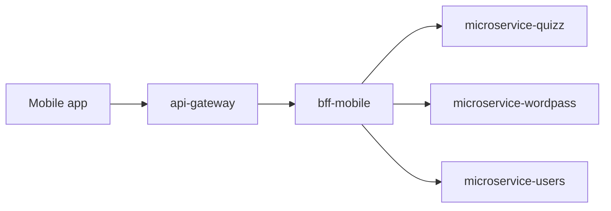

# bff-mobile

Last updated: 2026-05-08.

Backend-for-Frontend service for AxiomNode mobile clients.

## Responsibility

`bff-mobile` is the mobile channel facade. It provides mobile-shaped contracts while insulating the app from domain-service topology and internal contract churn.

Current platform status: mobile traffic enters through `api-gateway`, then flows through this BFF into `microservice-users`, `microservice-quizz`, and `microservice-wordpass`. Runtime AI generation remains behind the domain services, not exposed directly to mobile clients.

## Runtime role

### Runtime context

### Main responsibilities

- Expose mobile-oriented APIs with lightweight payloads.
- Orchestrate quiz and word-pass game flows.
- Isolate mobile clients from internal service topology changes.

## Runtime surface

### Concrete orchestration scope

`bff-mobile` is intentionally thin:

- it does not own business persistence
- it does not hold shared runtime routing state
- it translates mobile-facing requests into explicit downstream calls with mobile-shaped responses

Cross-repo mobile orchestration, payload semantics, and player-sync behavior are documented in the mobile gameplay capability dossier so this README can stay at repository level.

### Primary use cases

- serve random playable quiz and word-pass content
- trigger generation flows through downstream services
- aggregate mobile-ready responses with minimal coupling to internal service boundaries
- expose stable public mobile entry semantics behind the gateway layer

## Local setup

### Repository structure

- `src/`: Fastify + TypeScript implementation.
- `docs/`: architecture, guides, and operations docs.
- `.github/workflows/ci.yml`: CI + deployment dispatch trigger.

### Local development

1. `cd src`
2. `cp .env.example .env`
3. From `secrets`, run `node scripts/prepare-runtime-secrets.mjs dev`
4. `npm install`
5. `npm run dev`

### Client IP and rate limiting

Set `TRUST_PROXY` (default `false`; `true`/`false`, a hop count such as `1`, or a comma-separated IP/CIDR list) so `request.ip` is the real client address behind the ingress. `/v1/mobile/*` routes are limited in memory per client IP by `RATE_LIMIT_MAX` (default `120`, `0` disables) and `RATE_LIMIT_WINDOW_MS` (default `60000`); see `docs/operations/README.md`.

### Route note

This service owns the mobile-facing profile, category, random gameplay, generation, and event-sync routes. Use `docs/architecture/README.md` and the mobile gameplay capability dossier for the concrete inventory.

## Dependencies and contracts

### Dependency model

Primary downstream dependencies:

- `microservice-quizz`
- `microservice-wordpass`

Indirect runtime dependencies reached through those services:

- `ai-engine-api`
- `ai-engine-stats`

## Deployment and operations notes

### CI/CD and rollout note

CI and image publication are documented in `docs/operations/README.md` and `../docs/operations/cicd-workflow-map.md`.

### Internal dependencies

- `QUIZZ_SERVICE_URL`
- `WORDPASS_SERVICE_URL`
- `USERS_SERVICE_URL`

### State and persistence

`bff-mobile` is stateless. Player profile, game events and stats live in `microservice-users` (the system of record behind the leaderboard); the three player routes only forward to it:

- `GET /v1/mobile/player/profile` reads `/users/me/profile` (plus `/users/me/stats?recentLimit=1` for `lastPlayedAt` when the player has history) and maps it to the same `{ profile, stats }` shape as before.
- `PUT /v1/mobile/player/profile` calls `POST /users/firebase/session` (profile fields come from the verified token claims) and returns the refreshed summary. `preferredLanguage` is no longer stored and is always `null`.
- `POST /v1/mobile/games/events` calls the idempotent `POST /users/me/games/events/batch` (deploy `microservice-users` first) and returns `{ synced, message, stats }`.

#### Migrating the old JSON file

The former `PLAYER_DB_FILE` (default `./data/player-db.json`) is no longer read and the variable is ignored. Nothing is migrated automatically. If the file holds data worth keeping, its `events` array can be replayed once per player through the batch endpoint above (each event already carries `gameId`, `gameType`, `categoryId`, `categoryName`, `language`, `outcome`, `score`, `durationSeconds`, `timestamp`; lower-case the `outcome`), using a token of that player. Replays are idempotent, so a partial run can simply be repeated.

## Documentation

- `docs/README.md`
- `docs/architecture/README.md`
- `docs/guides/README.md`
- `docs/operations/README.md`

### Operational notes

- This service used to be part of the automatic staging deployment chain; that chain is disabled (the k3s host no longer exists and `platform-infra` `deploy.yaml` is manual-only).
- Validation failure prevents image publication for the triggering push.
- Docs-only pushes should not trigger central image publication anymore.

### Failure boundaries

- domain service unavailable or slow
- malformed downstream response that cannot be shaped into the mobile contract
- generation latency inherited from quiz/word-pass services

## References

- `docs/architecture/`
- `docs/operations/`
- `../docs/guides/capabilities/player/mobile-gameplay-orchestration.md`
- `../docs/operations/cicd-workflow-map.md`
